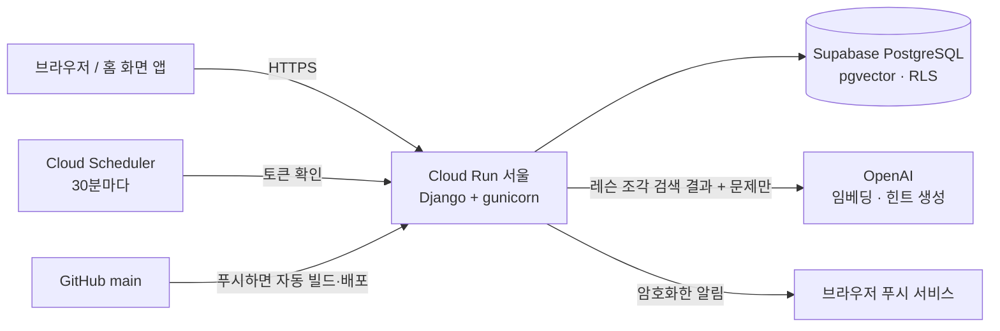

# 코드사수 (codesasu)

눈치 보며 묻던 코드, 이제 하루 10분이면 읽혀요.

AI가 짜 준 업무용 파이썬 코드를 **비개발 직장인**이 하루 10분씩 읽고, 고치고, 안전하게 내보내는 연습을 하는 학습 앱(PWA)입니다.

- 서비스: https://codesasu-429200157263.asia-northeast3.run.app/
- 개인 프로젝트 · 베타 테스트 2026.11.9 ~ 12.6

## 왜 만들었나

ChatGPT로 엑셀·파일 정리 코드를 받아 쓰는 직장인은 늘었지만, 코드가 **무슨 일을 하는지, 왜 에러가 나는지, 돌려도 안전한지**는 모른 채 실행합니다.
코딩 강의는 "처음부터 짜는 법"을 가르치는데, 이 사람들에게 필요한 건 "이미 있는 코드를 읽는 법"입니다.
코드사수는 옆자리 사수처럼, 정답을 바로 알려 주지 않고 스스로 읽어 내도록 이끄는 것을 목표로 합니다.

## 주요 기능

- **하루 한 레슨** — 업무 상황 레슨 14개(읽기 · 에러 · 내보내기 3갈래), 레슨마다 문제 2~3개. 배우기 전·후 실력을 재는 진단(A/B형)
- **4가지 문제 유형** — 결과 예측 · 에러 해석 · 고칠 줄 고르기 · 흐름 설명
- **사수 힌트 (AI)** — 막힌 문제에서 1단계(방향) → 2단계(위치) → 3단계(개념) 순서로 힌트. 레슨 본문을 근거로 검색해 만들고, 답변에 정답이 새면 서버가 막음
- **기록** — 주간 학습 현황, 레슨별 기록, 남은 레슨 기준 완주 예상일
- **매일 알림** — 정한 시각에 오늘의 레슨을 웹 푸시로 알림 (이미 공부한 날은 보내지 않음)
- **계정** — 가입 없이 첫 레슨 체험(게스트) → 가입하면 그 기록을 계정으로 이어받기. 구글 로그인 · 이메일 가입 · 비밀번호 찾기 메일
- **앱처럼 설치** — PWA (홈 화면에 추가, 아이폰 16.4+ 알림 지원)

## 구조



- **백엔드**: Django 5.2, django-allauth (구글 로그인 · 이메일 계정), JSON API (`/api/v1/`)
- **프론트**: 서버 템플릿 + 바닐라 JS, 서비스 워커(PWA · 푸시)
- **DB**: Supabase PostgreSQL + pgvector (레슨 조각 임베딩 검색)
- **AI**: OpenAI 임베딩 · 구조화 출력(JSON). 라이브러리 대신 `requests`로 직접 호출
- **배포**: Google Cloud Run (asia-northeast3), GitHub 푸시 → 자동 빌드

## 설계에서 신경 쓴 점

**정답을 말하지 않는 AI 힌트** (`learning/hints.py`)
- 레슨 본문을 300자 조각으로 나눠 임베딩해 두고, 문제와 가까운 조각 3개를 근거로 힌트를 만듭니다.
- 단계마다 "말해도 되는 것 / 말하면 안 되는 것"을 나눠 지시하고, 응답에 정답이 들어 있는지 서버가 다시 검사합니다. 걸리면 한 번 다시 만들고, 또 걸리면 고정 문구로 대신합니다.
- OpenAI로는 문제와 레슨 내용만 보내고 이메일·이름 같은 사용자 정보는 보내지 않습니다. 오류 메시지에 섞여 오는 API 키 일부도 가려서 기록합니다.
- 사용자당 하루 힌트 수를 제한합니다.

**레슨 코드는 배포 전에 실제로 실행해 검사** (`Dockerfile`, `learning/lesson_files.py`)
- 레슨은 TOML 파일로 관리합니다. 빌드 1단계에서 문제 코드를 실제로 실행해 정답·에러·고친 결과가 레슨 내용과 맞는지 확인하고, 하나라도 틀리면 빌드가 멈춰 배포되지 않습니다.

**웹 푸시를 표준대로 직접 구현** (`learning/webpush.py`)
- 많이 쓰는 pywebpush의 의존 패키지가 설치되지 않아, RFC 8291(aes128gcm 암호화)과 RFC 8292(VAPID 서명)를 `cryptography`·`PyJWT`로 직접 구현했고, RFC 예제 값으로 바이트 단위까지 맞는지 테스트합니다.
- 구독 주소는 실제 브라우저 푸시 서비스 도메인만 받아 서버가 임의 주소로 요청을 보내지 않게 했습니다(SSRF 방지).
- 예약 실행이 겹쳐도 하루 한 번만 보내도록 DB 고유 제약으로 막습니다.

**보안 기본값**
- 비밀 값은 모두 환경 변수로만 받고 저장소·이미지에 넣지 않습니다.
- Supabase의 모든 표에 RLS를 켜서 외부 Data API로는 아무 행도 보이지 않게 합니다(서버 시작 시 자동 적용).
- 로그인 시도 횟수 제한, 관리자 화면은 일반 로그인을 거치고 관리자 권한이 있어야 열림, 관리자 주소는 환경 변수로 숨김.
- 정답은 API 응답에 넣지 않고 서버에서만 채점합니다.

## 테스트

```bash
python manage.py test learning --settings=config.test_settings   # SQLite
```

API · 채점 · 힌트(정답 노출 차단) · 푸시 암호화 · 알림 발송 조건 · 계정/메일 흐름 · 배포 설정 등 143개 테스트. 같은 테스트를 PostgreSQL에서도 돌려 확인합니다.

## 로컬에서 실행

PostgreSQL(pgvector 확장)이 필요합니다.

```bash
pip install -r requirements.txt
cp .env.example .env        # 값 채우기 (아래 표)
python manage.py migrate
python manage.py sync_lessons
python manage.py runserver
```

| 환경 변수 | 용도 |
|---|---|
| `DJANGO_SECRET_KEY`, `DATABASE_URL`, `DEBUG` | 기본 설정 |
| `GOOGLE_CLIENT_ID`, `GOOGLE_CLIENT_SECRET` | 구글 로그인 |
| `OPENAI_API_KEY` | 힌트 (없으면 힌트 대신 안내 문구) |
| `VAPID_PRIVATE_KEY`, `PUSH_CRON_TOKEN` | 매일 알림 (없으면 알림 기능만 꺼짐) |
| `EMAIL_HOST_PASSWORD` | 메일 발송 (없으면 메일을 콘솔에 출력) |

## 폴더

```
config/              설정 · URL
learning/            앱 (모델, API, 힌트, 푸시, 관리 명령)
  management/commands/  sync_lessons · ingest_chunks · ensure_rls · funnel(단계별 이탈 리포트) · hint_check
lessons/             레슨 원본 (TOML)
templates/           로그인·가입·메일 화면 (allauth 덮어쓰기)
```

---

만든 사람: 정예린 · 개발 과정 기록 [개발일지](https://story7001.tistory.com/)
